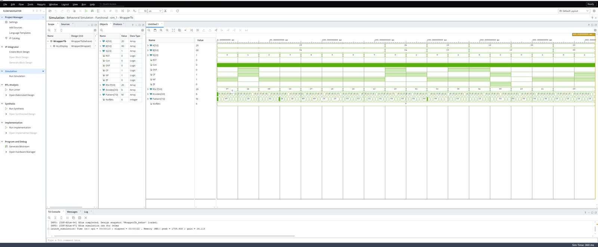
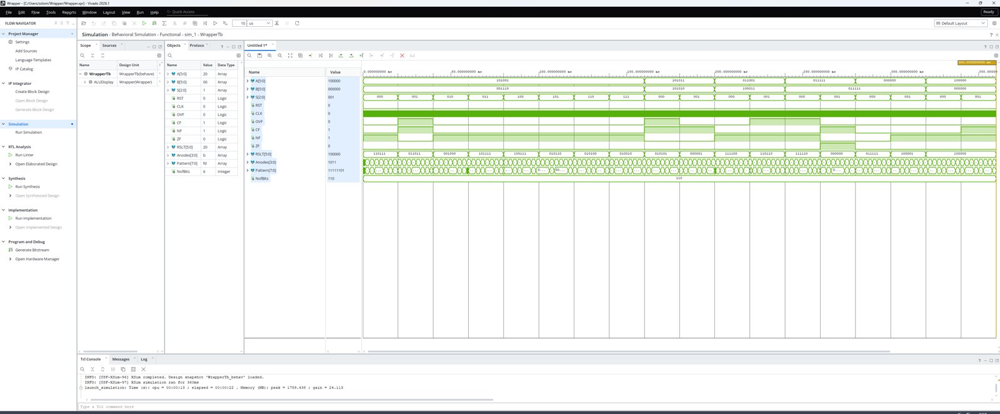
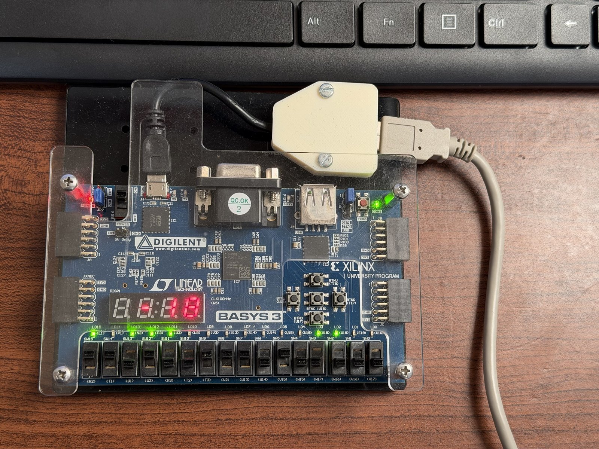
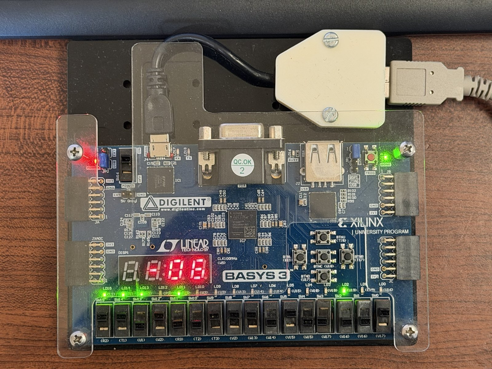
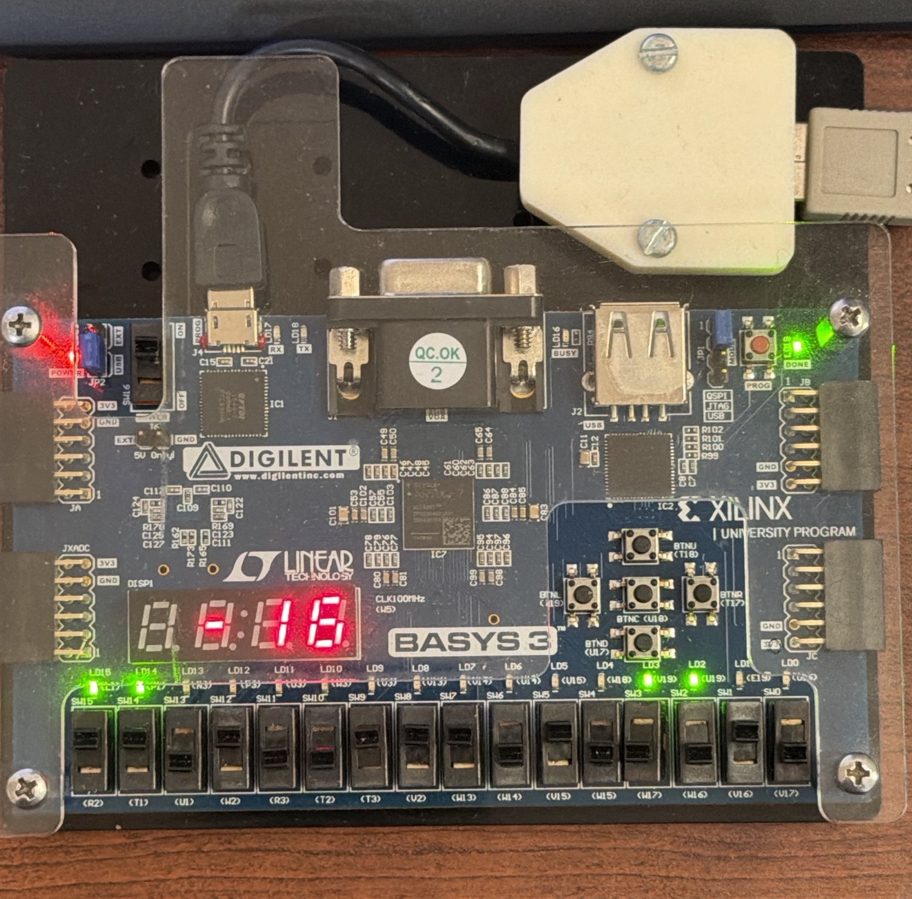
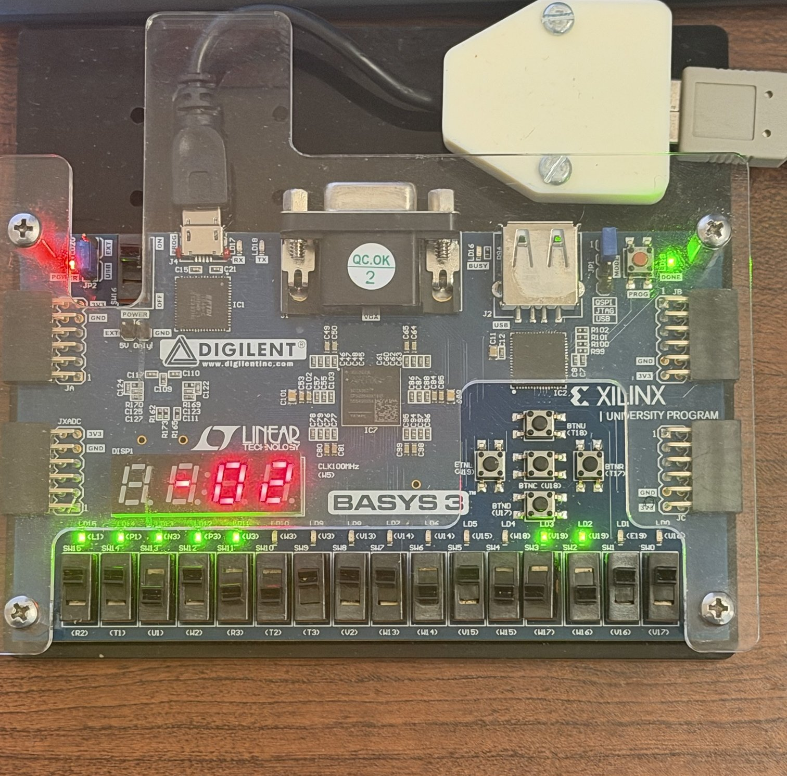
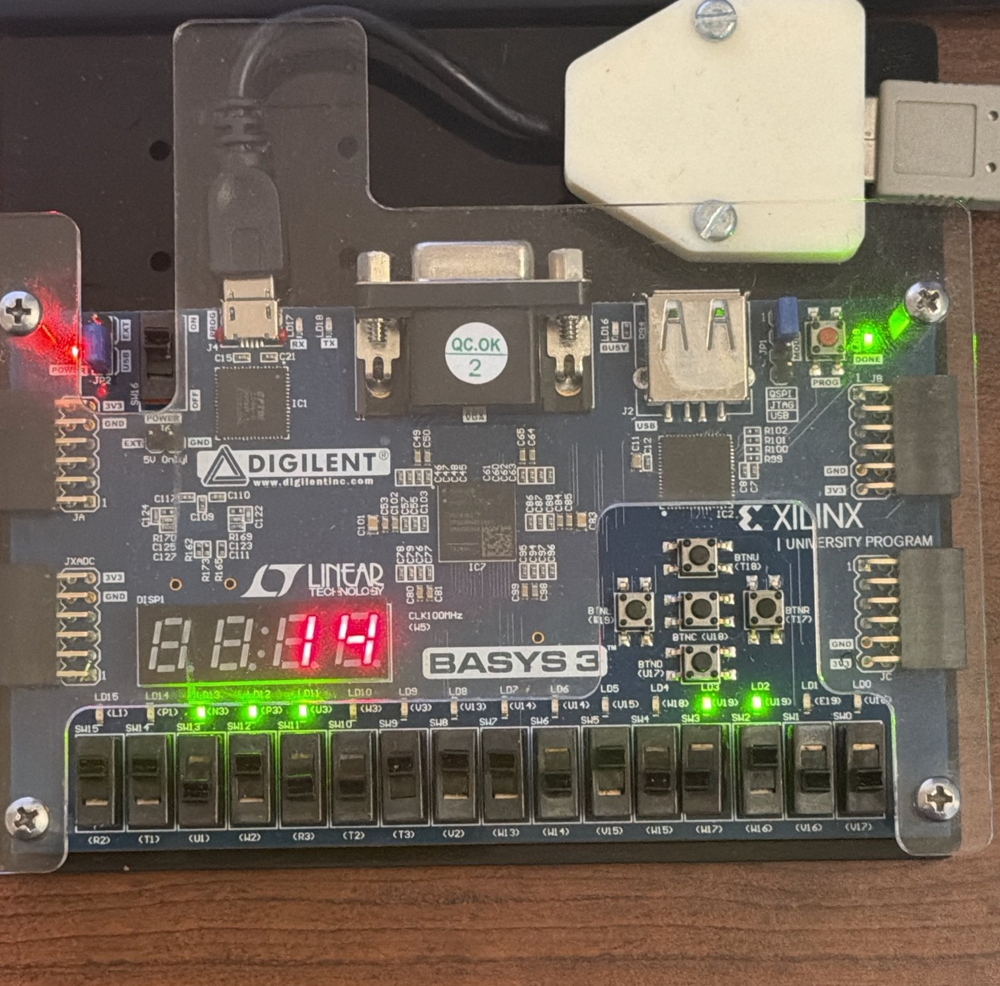
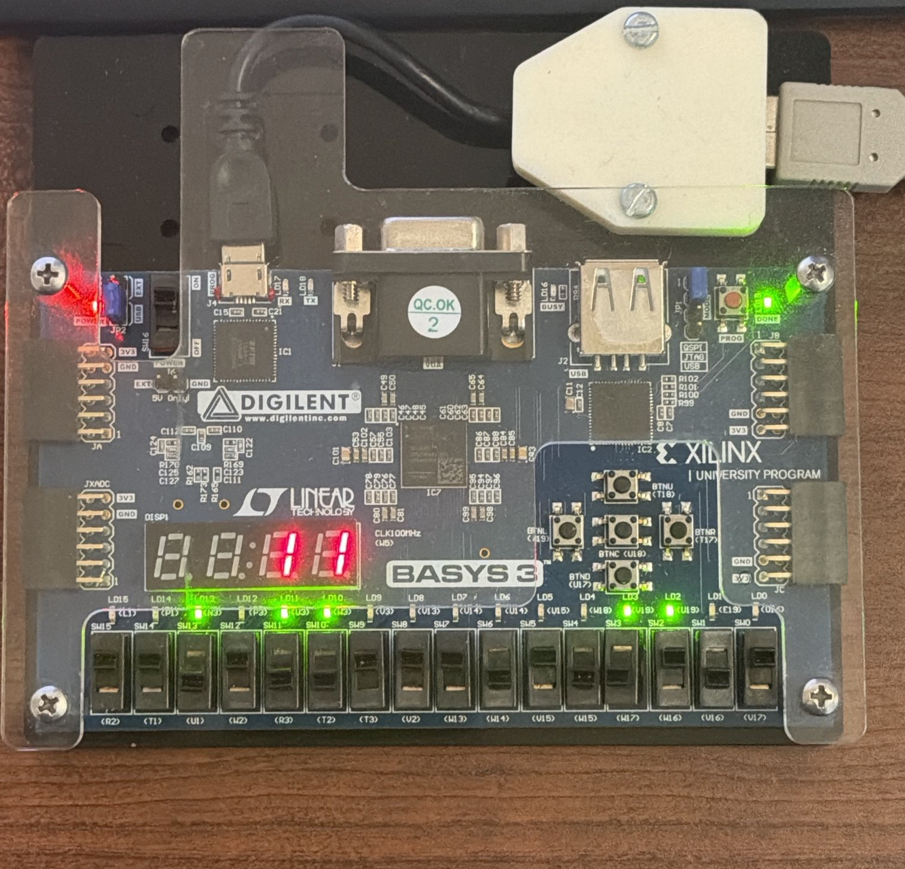
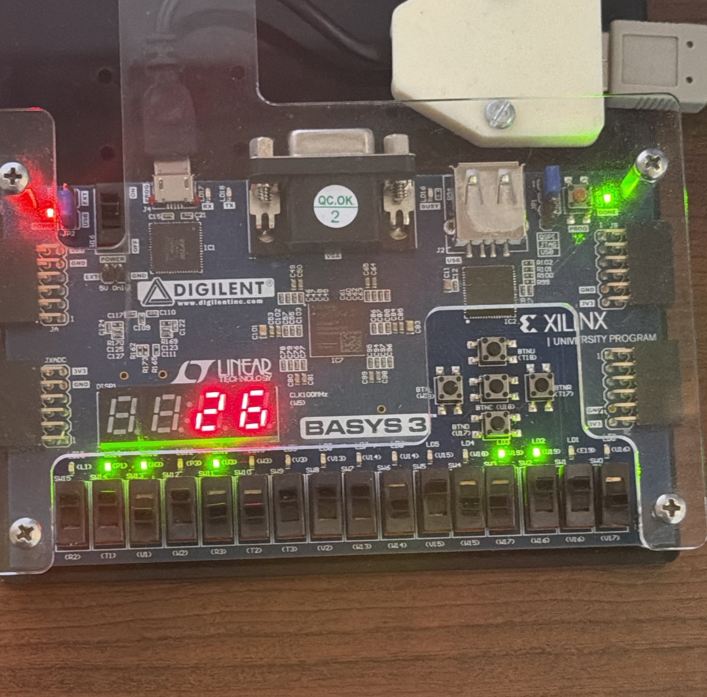
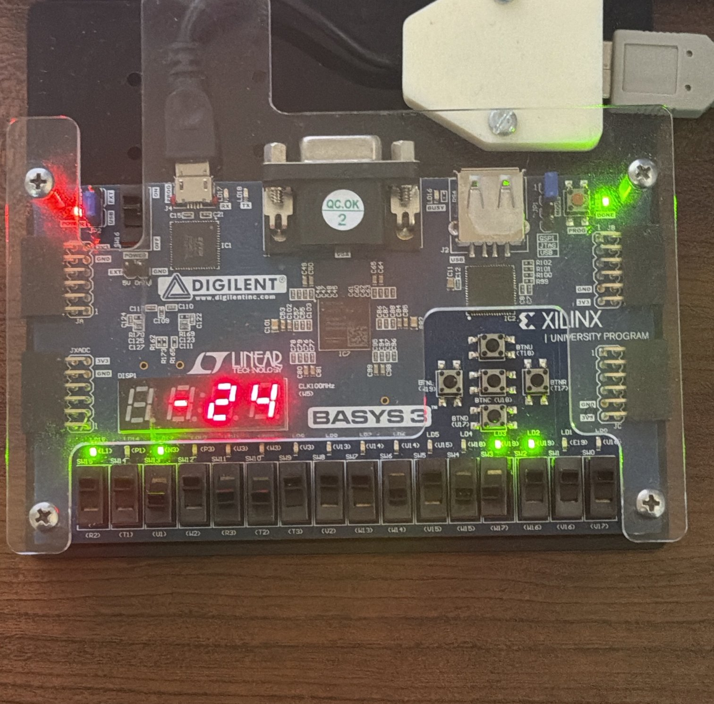

# CENG 356 - Lab 4: VHDL Design of ALU and its FPGA Implementation

**Student:** Solomon Ewusi
**Student ID:** N01659373
**Course:** CENG 356 - Computer Systems Architecture
**Institution:** Humber College

---

## Overview

This lab designs a 6-bit Arithmetic Logic Unit (ALU) in VHDL, simulates it in Vivado, and implements it on a Digilent **BASYS 3** FPGA board (Xilinx Artix-7, `xc7a35tcpg236-1`). A 3-bit control input `S` selects one of 8 operations. The ALU also produces four condition flags: Overflow (OVF), Carry (CF), Negative (NF) and Zero (ZF).

---

## Files

| File | Description |
|------|-------------|
| `src/ALU.vhd` | **Completed by me.** 6-bit ALU: logic operations, adder/subtractor connection, flags and MUX connections |
| `src/Mux.vhd` | **Completed by me.** 8-to-1 multiplexer that selects the ALU result |
| `src/CLA.vhd` | Carry look-ahead adder (provided) |
| `src/Wrapper.vhd` | Top-level module connecting the ALU to the board display (provided) |
| `src/WrapperTb.vhd` | Testbench used for the 360 ms simulation (provided) |
| `src/Display.vhd`, `Bin2BCD.vhd`, `SegDrv.vhd`, `CNT.vhd`, `INC.vhd`, `Pulser.vhd`, `RING.vhd` | 7-segment display support files (provided) |
| `src/ALU.xdc` | Pin constraints for the BASYS 3 board (provided) |
| `LAB 4 ONLINE REPORT - SOLOMON EWUSI.docx` | Lab report |
| `screenshots/` | Simulation screenshots and board test photos |

---

## Function Table

| S2 S1 S0 | Operation |
|---|---|
| 000 | A + B |
| 001 | A - B |
| 010 | A AND B |
| 011 | A OR B |
| 100 | A XOR B |
| 101 | NOT A (B not used) |
| 110 | Logical shift A right by one bit |
| 111 | Logical shift A left by one bit |

---

## Design Notes

- **Subtraction** uses the same adder: when `S = 001`, B is inverted (`B_l <= NOT B`) and the carry-in is set to 1, which forms the 2's complement of B.
- **Flags:**
  - `CF` = carry-out of the adder
  - `NF` = MSB of the sum (`Sum(n-1)`)
  - `ZF` = 1 when the sum is all zeros
  - `OVF` = 1 when two operands with the same sign give a result with the opposite sign:
    `(A(n-1) and B_l(n-1) and not Sum(n-1)) or (not A(n-1) and not B_l(n-1) and Sum(n-1))`
- The flags always come from the adder, so they are only meaningful for add (000) and subtract (001).

---

## Simulation (Vivado behavioral simulation, 360 ms)

For the first 160 ms the testbench holds **A = 101001, B = 001110** and steps S through all 8 codes:

| S | Function | RSLT | Decimal |
|---|---|---|---|
| 000 | A + B | 110111 | -9 |
| 001 | A - B | 011011 | 27 |
| 010 | AND | 001000 | 8 |
| 011 | OR | 101111 | -17 |
| 100 | XOR | 100111 | -25 |
| 101 | NOT A | 010110 | 22 |
| 110 | Shift right | 010100 | 20 |
| 111 | Shift left | 010010 | 18 |

From 160 ms to 360 ms it repeats add/subtract with new inputs to test the flags (for example, 011111 - 011111 = 000000 sets ZF = 1).

---

## FPGA Board Results (BASYS 3)

Switches: **A = 110100** (SW15-SW10), **B = 111010** (SW9-SW4), **S** on SW2-SW0.
LD15-LD10 show RSLT, LD3-LD0 show CF, NF, OVF, ZF, and the 7-segment display shows RSLT as a signed decimal.

| S | Function | LEDs (RSLT) | 7-segment display |
|---|---|---|---|
| 000 | A + B | 101110 | -18 |
| 001 | A - B | 111010 | -6 |
| 010 | AND | 110000 | -16 |
| 011 | OR | 111110 | -2 |
| 100 | XOR | 001110 | 14 |
| 101 | NOT A | 001011 | 11 |
| 110 | Shift right | 011010 | 26 |
| 111 | Shift left | 101000 | -24 |

| | |
|---|---|
|  **000 Add: -18** |  **001 Subtract: -6** |
|  **010 AND: -16** |  **011 OR: -2** |
|  **100 XOR: 14** |  **101 NOT A: 11** |
|  **110 Shift right: 26** |  **111 Shift left: -24** |

---

## How to Build and Run

1. Install **Vivado** (this lab used Vivado 2026.1 with the free BASIC license; 2019.x WebPACK also works).
2. Create a new RTL project named **Wrapper** with part **xc7a35tcpg236-1**.
3. Add all `.vhd` files in `src/` as design sources **except** `WrapperTb.vhd`, add `ALU.xdc` as a constraint, and add `WrapperTb.vhd` as a simulation source.
4. Set the simulation run time to **360 ms** and run **Behavioral Simulation**.
5. Run **Generate Bitstream**, then **Open Hardware Manager -> Open Target -> Auto Connect -> Program Device**.
6. Set the switches as described above and read the LEDs and 7-segment display.

---

## GitHub Repository
[https://github.com/SolomonEwusi9373/SolomonEwusiCENG356-Lab4](https://github.com/SolomonEwusi9373/SolomonEwusiCENG356-Lab4)
